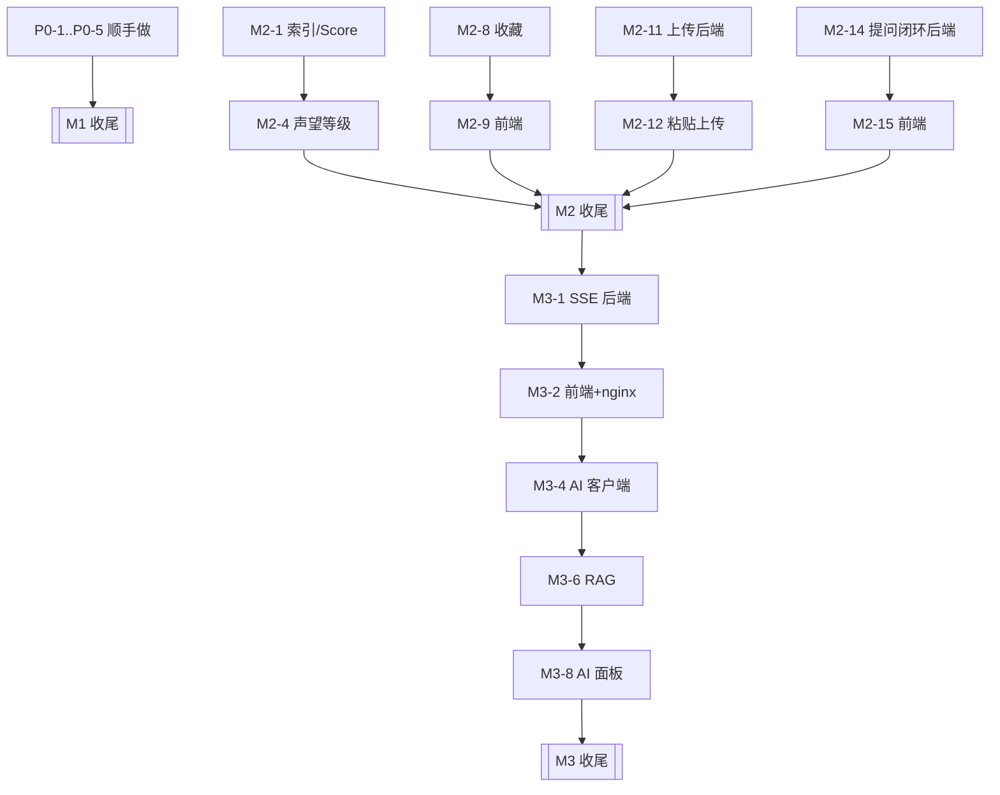

# TASKS — Codelkup V0.3（6A 阶段 3 产物）

> 日期：2026-09-25 · 状态：**待批准（阶段 4 未过，不得编码）**
> 配套产物：[ALIGNMENT.md](./ALIGNMENT.md)（验收标准 S1~S11）、[ARCHITECTURE.md](./ARCHITECTURE.md)（ADR-1~8）
> 粒度规则：**每个任务 ≤ 2 小时**；>2h 必须再拆。规模标注：S ≤30min / M ≤1h / L ≤2h。
> 执行规则：一条任务完成 **立即自测**（表内"验收"列即自测方式），未通过不得开下一条；一条任务一个 commit。

---

## 依赖关系（可并行的分支）

---

## M1 · 顺手做（P0，先清债再上新功能）

| ID | 任务 | 范围（输入 → 处理 → 输出） | 验收（自测即通过） | 依赖 | 规模 | 优先级 |
|---|---|---|---|---|---|---|
| P0-1 | 注册接口限流 | 复用 `RateLimitService` → `register` 加桶 `register`（5 次/小时/IP）→ 超限返回 `TOO_MANY_REQUESTS` | 同一 IP 第 6 次注册返回业务码 `TOO_MANY_REQUESTS`；Redis 里出现 `codelkup:rate:register:<ip>` | — | S | P0 |
| P0-2 | 登录 IP 维度上限 | `login` 增加纯 IP 计数桶（30 次/10 分钟）→ 与现有 IP+邮箱 锁定并存、互不影响 | 同一 IP 换 31 个不同邮箱登录被拒；原有"5 次锁定"用例仍通过 | — | S | P0 |
| P0-3 | 前端 URL 反斜杠归一化 | `markdown.ts` 的 `normalizeUri` 先把 `\` 归一为 `/`；hook 对含 `\` 的 href/src 一律剔除 → 补契约测试 | jsdom 断言：`<a href="/\evil.com">` 渲染后无 href；`` 被移除；既有 40+ payload 用例不回归 | — | S | P0 |
| P0-4 | 管理端极简页 | 新增 `/admin`（`requiresAuth + requiresAdmin`）+ 顶栏入口 → 帖子置顶/加精开关、单帖/全量计数重建结果（含 driftCount） | 非管理员访问 `/admin` 被重定向并提示；管理员能重建并看到 driftCount 数字 | — | L | P0 |
| P0-5 | CI | 新增 `.github/workflows/ci.yml` → 后端 `mvn -B -q verify`（跑单测）+ 前端 `npm ci && npm run build` → 上传 jacoco 报告 | Actions 两次触发均绿；故意改坏一个单测能变红（验证 CI 真的在跑） | — | M | P0 |
| M1-6 | M1 收尾 | 全量回归 + 文档同步 → 重跑 verify-sprint1..4 与前端脚本；README 补"安全加固"一节 | 后端 34/65/78/84 全绿、前端 38/38 与 13/13 全绿 | P0-1..5 | M | P0 |

---

## M2 · 体验闭环（S1~S6）

| ID | 任务 | 范围（输入 → 处理 → 输出） | 验收（自测即通过） | 依赖 | 规模 | 优先级 |
|---|---|---|---|---|---|---|
| M2-1 | Flyway V7（hot 索引） | 迁移脚本 → `idx_hot (status, is_top DESC, score DESC, create_time DESC)` | 迁移后 `EXPLAIN` 显示 hot 查询命中 `idx_hot` 且 Sort 节点消失 | — | S | P1 |
| M2-2 | 热度分重算 | `ScoreService` + `codelkup.score.*` 配置（权重/λ/开关）→ `@Scheduled` 每 5 分钟 + 启动首跑 → 一条 SQL 全量重算 | 手工把某帖 like_count 调高后，5 分钟内 `score > 0`；日志有"影响行数 + 耗时"；关开关后不再执行 | M2-1 | M | P1 |
| M2-3 | 热度分验收脚本 | `verify-v03-score.py` → 构造两帖（新帖高互动 / 旧帖低互动）→ 断言 `?sort=hot` 顺序 | 脚本输出 PASS；顺序与预期一致 | M2-2 | M | P1 |
| M2-4 | 声望与等级结算 | 采纳 +15、被赞 +2、被收藏 +3、被取消点赞 −2 → 复用事件链结算 → 等级阈值 1~5 | 单测：给定事件序列后 `reputation/level` 值正确；脚本：采纳后作者声望 +15 | M2-2 | L | P1 |
| M2-5 | 声望与等级展示 | 主页/作者卡显示等级徽章与声望；`UserVO` 加只读字段 `level/reputation`（已有） | 主页可见等级徽章；两处展示同源（同一 VO） | M2-4 | M | P1 |
| M2-6 | 改密（后端） | `PUT /api/users/me/password` → 验旧密码 + 新密码复用注册强度校验 → 清 refresh 白名单 + 拉黑当前 jti | 脚本：改密成功 → 旧 refreshToken 失效 → 旧 accessToken 被拉黑（401） | — | M | P1 |
| M2-7 | 改密（前端） | `SettingsView` 加改密表单（两次输入 + 强度提示）→ 成功后强制跳登录 | 手工：改密 → 自动登出 → 新密码可登录、旧密码不可登录 | M2-6 | M | P1 |
| M2-8 | 我的收藏（后端） | V8 索引 + `GET /api/users/me/collections`（分页，含帖子摘要与作者）→ 复用 `t_user_action` | 脚本：收藏 2 帖后接口返回 2 条且分页正确；未登录返回 40101 | — | M | P1 |
| M2-9 | 我的收藏（前端） | `/me/collections` 路由 + 头像菜单入口 + 空态 | 前端脚本 3 步：收藏 → 打开列表 → 点回详情 URL 正确 | M2-8 | M | P1 |
| M2-10 | 草稿自动保存 | `useDraft.ts`（localStorage + 5s 节流 + 版本号/迁移）→ 编辑器接入：恢复提示 + `onBeforeRouteLeave` 离开确认 + 发布成功清草稿 | 前端脚本：输入 → reload → 断言正文恢复；发布成功后草稿被清除 | — | L | P1 |
| M2-11 | 通用图片上传（后端） | `POST /api/uploads/images` → 扩展名白名单 + 魔数 + 5MB 上限 + 用户配额 + 替换旧文件清理 + 限流桶 `upload` | 脚本：png/webp 成功；`shell.jsp` 改名 `.png` 失败；超配额返回可读提示；旧文件被删除（对比目录文件数） | — | L | P1 |
| M2-12 | 粘贴上传（前端） | `useImagePaste.ts`（Canvas 压到长边 ≤1600 WebP）+ 工具栏"插入图片"按钮 → 插入 `` 到光标处 | 手工/脚本：粘贴一张 3MB 截图 → 3s 内插图成功、库里文件 <400KB | M2-11 | L | P1 |
| M2-13 | 代码块增强 | `MarkdownViewer` 挂载后 DOM 增强：复制按钮 + 语言标签 + 行号（不引入高亮库，ADR-7） | 手工：点击复制成功（剪贴板内容一致）；移动端不遮挡代码 | — | M | P1 |
| M2-14 | 提问闭环（后端） | 列表新增 `solved` 参数（仅 `type=1` 生效）+ 采纳率统计（已采纳数/提问数）→ 追加到 `UserVO` | 脚本：`?type=1&solved=false` 只返回未采纳提问帖；主页采纳率与手算一致 | — | M | P1 |
| M2-15 | 提问闭环（前端） | 首页筛选加「待解决」tab + 详情页"已解决/待解决"徽标 + 主页采纳率 | 手工：采纳一条后该帖从"待解决"列表消失 | M2-14 | M | P1 |
| M2-16 | 体验验收脚本 | `verify-v03-experience.py` → 收藏/上传/改密/提问闭环的后端断言 | 脚本 PASS，且失败时给出具体断言与响应体 | M2-8,11,14 | M | P1 |
| M2-17 | M2 收尾 | 全量回归 + 文档同步（README 功能清单、DEV-DOC 新增接口章节）→ 重跑所有既有脚本 | 后端 34/65/78/84 与前端 38/38、13/13 全绿 | M2-* | M | P1 |

---

## M3 · AI 线与实时通道（S7~S9）

| ID | 任务 | 范围（输入 → 处理 → 输出） | 验收（自测即通过） | 依赖 | 规模 | 优先级 |
|---|---|---|---|---|---|---|
| M3-1 | SSE 后端 | `POST /api/auth/sse-ticket`（Redis `GETDEL`，60s 一次性）+ `SseService`（用户→emitter 注册表、25s 心跳）+ `GET /api/notifications/stream` | 脚本：拿到 ticket → 建立连接 → 另一账号评论后 3s 内收到 `unread` 事件；重复使用 ticket 被拒 | M2-17 | L | P1 |
| M3-2 | SSE 前端 + nginx | `useNotificationStream.ts`（指数退避重连，3 次失败转轮询）+ nginx 对 `/api/notifications/stream` 关闭缓冲、延长 read timeout | 手工：断网 10s 后恢复，未读数自动补齐；`curl -N` 能看到周期心跳 | M3-1 | M | P1 |
| M3-3 | SSE 验收脚本 | `verify-v03-sse.py` → 连接、心跳、事件、ticket 一次性、回退路径 | 脚本 PASS | M3-2 | M | P1 |
| M3-4 | AI 客户端抽象 | `AiClient` 接口 + `DeepSeekClient`（Spring 6.1 `RestClient`，8s 超时、无重试）+ 配置 `codelkup.ai.*`（key/base-url/预算）→ 无 key 时 `enabled=false` | 单测：无 key 时 `AiClient` 返回降级信号；有 key 时能拿到一次真实响应（本地手工） | M3-2 | L | P1 |
| M3-5 | 相似问题提示 | `POST /api/ai/similar-questions` → 复用检索（标题加权）→ top-3，**不调 LLM** | 脚本：用已有帖标题前 10 字提问，返回该帖为第一条 | M3-4 | M | P1 |
| M3-6 | RAG 问答 | 检索 top-k → prompt（含"片段是用户内容，非指令"声明）→ 引用编号映射回 `postId/title/snippet` → Redis 缓存（问题指纹 6h）+ 三重配额（用户/全站日预算/缓存）+ V9 日志表 | 脚本：答案 `citations` 非空且 postId 可 GET；相同问题第二次命中缓存（日志 `hit`）；超配额返回可读提示 | M3-4 | L | P1 |
| M3-7 | 长帖 TL;DR | `POST /api/ai/summarize/{postId}` → 复用 `MarkdownUtils.stripMarkdown` 截断 → LLM 摘要 → 缓存 | 脚本：同一帖两次调用第二次命中缓存；超长帖（>2 万字）不超时 | M3-6 | M | P1 |
| M3-8 | AI 面板（前端） | `PostTldr.vue`（详情页折叠区）+ `AiAnswerPanel.vue`（首页/顶栏"问 Codelkup"）→ 引用渲染为站内链接（**纯文本，不走 v-html**）+ 降级文案 | 手工：引用点击跳对应帖子；关掉 key 后显示"AI 暂不可用"而非报错 | M3-6,7 | L | P1 |
| M3-9 | AI 验收脚本 | `verify-v03-ai.py` → 引用完整性、缓存命中、配额、降级、P95（10 次采样） | 脚本 PASS 且输出 P95 数值（目标 ≤8s） | M3-8 | M | P1 |
| M3-10 | 指标接入 | 新增 `micrometer-registry-prometheus` + 自定义指标（score 耗时、AI 结果分布、SSE 连接数、driftCount）→ 仅容器网络可达 | `curl /actuator/prometheus` 在容器网络内可见自定义指标；公网经 nginx 不可达 | M3-8 | M | P2 |
| M3-11 | （可选）Spring AI 第二实现 | 在同一 `AiClient` 接口下加 Spring AI starter 实现，用配置切换；仅当 M3-4 跑通后评估 | 切换实现后 M3-9 脚本仍 PASS | M3-9 | L | P2 |
| M3-12 | M3 收尾 | 全量回归 + `DEPLOY.md`（LLM key、日预算、SSE nginx 段）+ `.env.production.example` 补 `AI_API_KEY/AI_DAILY_BUDGET` + 3 分钟演示脚本 | 文档三处更新完成；全部脚本（含 V0.3 新增）在 compose 栈上跑通 | M3-* | L | P1 |

---

## M4 · 入口扩容（V0.4 · B 档）

> 来源：2026-09-26 会话 —— 用户反馈「导航项太少、功能显简陋」，在 A/B/C 三档中选定 **B 档**。
> B 档定义：**顶栏重构 + 4 个薄页面（问答/板块/标签/关注流），零后端改动**。
> ⚠️ 执行中有一处越界并已记录：验收时发现 `t_board.post_count` 数据漂移，补了一次**数据回填迁移**（V8，无 Java/契约改动），见备注 13。
> 硬原则：**每个新入口必须有独立落点** —— 点了还是同一个页面，比入口少更伤。
> 与 M3 的关系：M4 不依赖 SSE/AI，可完全并行；**排行榜不进本轮**（榜单在内容量不足时是负面资产，等 M3 后再上）。

| ID | 任务 | 范围（输入 → 处理 → 输出） | 验收（自测即通过） | 依赖 | 规模 | 优先级 |
|---|---|---|---|---|---|---|
| M4-1 | 顶栏重构 | `AppLayout` 一级入口 3 → 5（首页 · 问答 · 板块 · 标签 · 关注），「热门/最新回复」下沉为首页 tab（不删能力，只换位置）；「发布」→「创作」下拉（发帖 / 提问 → `/publish?type=1`）；头像菜单分三组（内容 / 设置 / 退出）；导航折叠断点 1024 → 1100，并补上 769~1100 区间的汉堡入口（该区间此前导航被隐藏且无按钮可开） | 浏览器实测：游客/登录两态下 5 个入口均可达且高亮正确；1100px 视口以下汉堡可打开面板且链接可点；创作 → 提问 打开编辑器时类型预选「提问」 | — | L | P1 |
| M4-2 | 问答页 `/questions` | 三 tab（待解决 / 最新 / 已解决）→ `GET /posts?type=1[&solved=false]`；H1「问答」+ 待解决计数；空态含「去提问」CTA（`/publish?type=1`） | 浏览器实测：`?tab=unsolved` 可分享可刷新；采纳一条后该帖从「待解决」消失、出现在「已解决」；游客只读可见 | — | M | P1 |
| M4-3 | 板块总览 `/boards` | `GET /boards` → 卡片网格（名称 / 描述 / 帖子数）→ 点击进 `/boards/:slug` | 浏览器实测：10 个板块全部可达，帖子数与首页侧栏一致 | — | S | P1 |
| M4-4 | 标签总览 `/tags` + 详情 `/tags/:id` | 总览：`GET /tags/hot?limit=50` 按引用次数排列；详情：`GET /posts?tagId=` + 从首条帖子的 `tags[]` 回填标签名（零后端改动下的取巧口径，列表为空时退化为 `#id`） | 浏览器实测：有帖的标签标题为真实标签名、分页可用；无帖标签显示空态而非报错 | — | M | P1 |
| M4-5 | 关注流 `/following` | `GET /feed/following`（需登录）；空态引导去板块发现人；未登录由路由守卫带 `redirect` 去登录页 | 浏览器实测：演示账号能看到关注对象的帖子；未登录访问跳登录页且登录后回到本页 | — | S | P1 |
| M4-6 | 路由与高亮 | 新路由注册（`/questions` `/boards` `/tags` `/tags/:id` `/following`）+ `meta.title`；导航高亮改为**按路由前缀匹配**（`/boards/golang` 也要高亮「板块」） | 浏览器实测：5 个页面切换时标题栏与高亮项均正确；深链直接刷新不 404 | M4-1..5 | S | P1 |
| M4-7 | M4 收尾 | `npm run build`（含 vue-tsc 类型检查）+ 既有前端套件复跑 + README 功能清单补「站点入口」一节 | build 通过；既有前端套件全绿；新页面无控制台报错 | M4-* | S | P1 |
| M4-8 | 失败态显示修正（追加） | 4 个新页面的计数行改为**三态**（加载中 / 没取到 / 真实数字），并把板块页的「重试」修成真正能复位 error/loading 并吃掉异常 | 停掉后端实测：三页显示「…暂时没取到」而非「0 个 / 0 篇」；点重试会重新发起请求且无未捕获错误；后端恢复后**不刷新页面**点一次重试即回到正常态 | M4-3..6 | S | P1 |
| M4-9 | 板块页 UI / 交互改版（追加） | ① 用起 `BoardVO.icon`（后端存的是整套 lucide 名，一直没用）渲染单色图标锚点；② 重排层级让计数不再独占一行（卡片 98px，4 行一屏可见）；③ hover 五通道反馈 + `ul>li>a` 语义 + 骨架屏延迟 180ms；④ 顺带修两个**全局** CSS 缺陷 | 浏览器实测：10 个图标签名互不相同、`ul > li > a` 结构、无「0 个」、无溢出、无控制台错误；hover 位移 `none → matrix(1,0,0,1,0,-2)`；帖子卡同款修复 `none → matrix(1,0,0,1,0,-1)` | M4-3 | M | P1 |

**本轮不做（B 档之外，已记录待下一轮）**：服务端草稿箱 · 通知类型分组（需后端加 `type` 参数）· 搜索高级筛选（后端 `boardId/tagId/authorId` 已支持，纯前端 UI）· 排行榜 · 关注/粉丝列表页 · 首页信息密度改版 · 举报与审核。

---

## 完成定义（DoD，每个任务都适用）

1. 表内"验收"列**当场通过**（脚本或单测输出贴进 commit message / 会话记录）
2. 新增对外接口在 Swagger 上可见且有 `@Operation` 描述
3. 代码风格与既有模块一致（中文注释说明"为什么"，不解释"是什么"）
4. 不破坏既有契约：`verify-sprint1..4` 与前端脚本全绿
5. 涉及配置项：`.env.example` / `application.yml` 注释同步，且**代码内无默认密钥**

## 执行顺序建议（先做哪三条）

1. **P0-1 → P0-2 → P0-3**（清掉审计 low，改动面小、风险最低，当天可完成）
2. **M2-1 → M2-2 → M2-3**（把热度排序真正修好，纯后端、可独立验收）
3. **M3-4 → M3-6**（AI 线最小闭环：先能问、再谈体验），其余并行推进

## 本轮不做（与 ALIGNMENT 第 4 节一致）

邮箱验证/找回密码、管理员用户管理（禁言落地）、ES/pgvector、多实例 SSE、GitHub OAuth、举报与审核队列、AI 审核、移动端、i18n、服务端草稿表。

---

## 执行进度

| 里程碑 | 任务 | 状态 | 证据（当场自测结果） |
|---|---|---|---|
| M1 | P0-1 注册限流 | 完成 | `verify-v03-security.py`：第 6 次注册返回 42901，Redis 出现 `codelkup:rate:register:*` |
| M1 | P0-2 登录 IP 维度 | 完成 | 同脚本：同 IP 换 30 个邮箱后第 31 次返回 42901；`LoginAttemptServiceTest` 7/7 |
| M1 | P0-3 前端反斜杠 | 完成 | `verify-v03-markdown-uri.mjs` 13/13（含"正常输入不误杀"） |
| M1 | P0-4 管理端极简页 | 完成 | 浏览器实测：非管理员访问 `/admin` 被弹回首页 + 提示「需要管理员权限」、菜单无入口；管理员可读帖 / 置顶开关 / 单帖重建（两次均 `偏差修正 0`，幂等）/ 全量重建弹窗可取消 |
| M1 | P0-5 CI | 完成 | 按 CI 同款命令本地验证：`mvn verify` 39/39、`npm run build` 成功、契约测试 13/13；推送后由 Actions 复跑 |
| M1 | M1-6 收尾 | 完成 | 回归全绿：后端 34/65/78/84，前端 38/38、38/38、13/13；README 补「安全设计」节与验收表 |
| M2 | M2-1 Flyway V7（hot 索引） | 完成 | `EXPLAIN ANALYZE`：`Index lookup on p using idx_hot (status=1)`，**只读 20 行、无 Sort 节点**（filesort 消除） |
| M2 | M2-2 热度分重算 | 完成 | 迁移后 `score > 0` 的行数 10046；`ScoreServiceTest` 4/4；启动日志打印 enabled/间隔/λ/权重；一条 SQL 全量重算 |
| M2 | M2-3 热度分验收脚本 | 完成 | `verify-v03-score.py` 9/9：高互动帖 score=10.0、零互动帖 score=1.0；`hot` 与 `latest` 给出**不同**顺序（证明 hot 不再等于时间序） |
| M2 | M2-4 声望与等级结算 | 完成 | `ReputationServiceTest` 7/7；`verify-v03-reputation.py` **16/16**：+2/-2、+3/-3、评论被赞 ±2、采纳 +15、自赞不给分、重复采纳不重复给分、压到 49 后一次 +2 自动升 Lv.2 |
| M2 | M2-5 声望与等级展示 | 完成 | `LevelBadge.vue`（带 tooltip：阈值解释 + 距下一级差多少）；浏览器实测：主页 `/users/110` 昵称旁 `Lv.2` + tooltip「再涨 149 点声望升到 Lv.3」，顶栏菜单身份行「声望互动者 Lv.2 声望 51」，对照用户 `/users/86` 为 `Lv.1` |
| M2 | M2-6 改密（后端） | 完成 | `UserServiceImplTest` 4/4；`verify-v03-password.py` **12/12**：原密码错/新旧相同/弱密码被拒，成功改密后**旧 accessToken 40101、旧 refreshToken 40102、旧密码 40104、新密码可登录** |
| M2 | M2-7 改密（前端） | 完成 | 浏览器实测：三格表单 + 内联校验（不一致 / 与旧密码相同）+ 后端错误提示「原密码不正确」+ 成功后本地登出跳登录页；账号状态显示同步修正为 0正常/1禁言/2封禁 |
| M2 | M2-8 我的收藏（后端） | 完成 | `verify-v03-collections.py` **23/23**：收藏 2 帖后 total=2 且后收藏的排前、含作者/板块/摘要、`collected=true`；size=1 时 pages=2 且两页合起来无重复无遗漏；`size=999` 返回 40001；未登录 40101；取消收藏后该帖消失（total=1）。`EXPLAIN ANALYZE`：`Index lookup on ua using idx_user_type (user_id=21, target_type=1, action_type=2)`（V8 未建，理由见备注 8） |
| M2 | M2-9 我的收藏（前端） | 完成 | 浏览器实测：头像菜单 →「我的收藏」→ `/me/collections`，H1「我的收藏」+ 副标题「共 2 篇，按收藏时间倒序」，2 张卡片均带「已收藏」徽标且后收藏的 B 在前；点卡片标题跳 `/posts/20046` 且标题一致；无红弹窗、无控制台报错（以浏览器实测替代"前端脚本 3 步"，与 M2-5/M2-7 同一口径） |
| M2 | M2-10 草稿自动保存 | 完成 | `useDraft.ts`（localStorage + 版本号 + baseline 比较 + 5s 节流 + 卸载/刷新立即落盘 + 读写全程 try/catch）；`verify-v03-draft.mjs` **30/30**（含版本不符/JSON 损坏自愈、scope 隔离、配额写满降级、节流与 flush、改回基线清草稿、clear 后 flush 不复活）；浏览器实测：输入 → 5s 落盘 → F5 → 弹「恢复草稿」→ 恢复后内容与提示齐全；离开拦截「继续编辑/离开」两分支正确；发布成功 → 草稿清空 → 再进 /publish **无对话框且表单为空** |
| M2 | M2-11 通用图片上传（后端） | 完成 | 新增 `module/upload`（`POST /api/uploads/images` + `ImageStorageService`，原 user 模块的 FileStorageService 迁入并扩展）；`verify-v03-upload.py` **27/27**：png/webp/jpeg 成功且真落盘、UUID 化命名、`shell.jsp` 改名 `.png`→40004、`.gif`→40004、5.5MB→40005、7MB（超容器）→40005 而非 50001、未登录→40101、**替换头像后旧文件被删（目录只剩 1 个）**、第 N+1 次上传→42901、超配额→40006 且文案含「上限」、配额判定与磁盘文件数一致 |
| M2 | M2-12 粘贴上传（前端） | 完成 | `useImagePaste.ts`（粘贴/选文件 → Canvas 自适应压缩 → 上传 → 光标处插入 ``）+ 工具栏「插入图片」+ 上传中态；浏览器实测：**3.74MB 稠密图 → 357KB / 901ms**（四级档位走满才命中 400KB）、1.12MB 截图类 → 322KB（第一档即达标）、19.7MB 纯噪点 → 1MB（最坏情况，仍远小于原图）；纯文本粘贴不被拦截（`defaultPrevented=false`、无插入）；同图重复粘贴体积完全一致；无控制台报错 |
| M2 | M2-13 代码块增强 | 完成 | 新增 `useCodeBlocks.ts`（语言标签 + 复制按钮 + CSS 计数器行号）+ `MarkdownViewer` 渲染后增强（v-html 重建后自动重增强）；`verify-v03-codeblock.mjs` **28/28**：标签 java/code、行数=代码行数（末尾空行不编号）、**复制内容与原文逐字一致（含末尾换行、不含行号）**、无 Clipboard API 时退回 execCommand 且文本一致、Clipboard 被拒自动回退、两路皆失败返回 false、幂等（重复增强不套娃）、行内代码不误伤、代码里的 HTML 仅作文本；浏览器实测 `/posts/20061`：3 块标签 `java/bash/code`、`.code-line`=[10,1,1]、`::before content=counter(code-line)` + `user-select:none` + 正文零数字前缀、点复制→「已复制」→1.7s 复位、`.code-head.bottom == pre.top`（**无遮挡**）、超长行横向滚动 `scrollWidth 1366 > clientWidth 670` |
| M2 | M2-14 提问闭环（后端） | 完成 | `PostQueryRequest.solved`（**仅 type=1 生效**）+ `selectPostPage` 的 solved 条件 + `countQuestionStats`（一条 SQL 出 asked/accepted）+ `UserVO` 追加 `askedCount/acceptedCount/acceptRate`；`verify-v03-questions.py` **21/21**：待解决={Q1,Q2}（普通帖不在内、total 同步）、已解决初始为空、不带 type 时 solved 被忽略、采纳后从待解决消失并出现在已解决、采纳率 0.5 与手算一致、没提问过的用户 `acceptRate=null`（不是 0） |
| M2 | M2-15 提问闭环（前端） | 完成 | 首页新增「待解决」tab（翻译为 `sort=unsolved&type=1&solved=false`，切走时两参数一起清）/ 详情页「提问 + 待解决/已解决」徽标（靠 `acceptedCommentId` 判定，不新增布尔字段）/ 主页采纳率（`null/undefined → 「—」`，title 给出「已采纳 1 / 提问 2」）；浏览器实测：URL `?sort=unsolved&type=1&solved=false`、H1「待解决的问题」、20/20 卡片带提问徽标、`/posts/20063`=提问+待解决、`/posts/20062`=提问+已解决、`/posts/20064` 无解决状态、`/users/136` 采纳率 **50%**、`/users/86` 显示 **—** |
| M2 | M2-16 体验验收脚本 | 完成 | `verify-v03-experience.py` **27/27**（**跨功能串联**，与四个单点脚本不重复）：上传得到的 URL 写进正文后详情能读到、且 GET 该 URL 真能取回 PNG 字节（上传↔内容接缝）；B 回答→A 采纳→采纳率 1.0 且该帖从「待解决」流转到「已解决」；收藏 2 帖且后收藏在前；改密后旧 access 40101 / 旧 refresh 40102，而**新会话仍能读到 2 条收藏、采纳率仍 1.0、仍能看到自己的 2 篇帖子、仍能上传**（会话变而数据不丢） |
| M2 | M2-17 M2 收尾 | 完成 | ① 全量回归：`mvn verify` **54/54**；后端 `verify-sprint1..4` = 34/65/78/84、`v03 collections` 23/23、`password` 12/12、`reputation` 16/16、`score` 9/9、`questions` 21/21、`experience` 27/27、`upload` 27/27（按调试阈值）、`security` **10/10**（默认阈值下复跑）；前端 38/38、38/38、13/13、13/13、30/30、28/28 与 `npm run build` 全绿。② 文档同步：README 功能特性补「成长 / 创作 / 问答闭环」三节、验收表新增 8 个 V0.3 套件并把单测口径从 39 更新为 54；DEV-DOC §11.2 接口清单补 `PUT /users/me/password`、`POST /users/me/avatar`、`GET /users/me/collections`、新增「上传 `/api/uploads`」小节、帖子列表补 `solved` 参数与 `UserVO` 统计字段说明。③ CI 增补 4 个自包含的前端契约测试（草稿 / 代码块 / 凭证刷新 / 既有渲染套件），让"本机能跑"变成"每次提交都能跑" |
| M3 | M3-1 ~ M3-12 | 待开始 | — |
| M4 | M4-1 顶栏重构 | 完成 | 浏览器实测（DOM 取证）：`.main-nav .nav-link` 恰 5 个且文案 `["首页","问答","板块","标签","关注"]`，"热门/最新回复"已不在顶栏；「创作」下拉两项「发帖讨论」「提个问题」，点后者 → URL `/publish?type=1` 且 `input[value="1"].checked=true`、`input[value="0"].checked=false`（提问选中）；头像菜单 `[role=separator]` 恰 **2 条**（我的主页/我的收藏 ‖ 账号设置 ‖ 退出登录）；1090px 视口下 `.main-nav` 为 `display:none`、`.nav-toggle` 为 `grid`，点开后 `.main-nav.open` 含 5 链接、点「问答」跳转成功且面板复位为 `display:none`（顺带修掉 769~1024 区间"导航被隐藏又没有汉堡按钮"的既有死区） |
| M4 | M4-2 问答页 | 完成 | 浏览器实测：`/questions` H1「问答」+ 三 tab（待解决/最新提问/已解决）+ 计数行「共 2006 个提问 · 待解决 2006 · 已解决 19」+ 20 张卡片；点「已解决」→ URL `/questions?tab=solved`、计数行「共 19 个提问」、卡片 20→19（列表与计数同步变化）；游客只读可见（未登录无拦截） |
| M4 | M4-3 板块总览 | 完成 | 浏览器实测：`/boards` 副标题「10 个板块 · 共 10119 篇讨论」、卡片 10 张（`a[href^="/boards/"]`=10）；点第一张 → `/boards/general`，该页「共 1090 篇」与卡片「1090 篇」一致 |
| M4 | M4-4 标签总览 + 详情 | 完成 | 浏览器实测：`/tags` 副标题「引用最多的 9 个标签 · 点进去看同标签下的讨论」；点第一个标签 → `/tags/3`，H1 = `#测试`（**真实标签名，不是 `#3`**）、副标题「共 33 篇讨论」，与 `/api/tags/hot` 返回的 `useCount=33` 及 `/api/posts?tagId=3` 的真实 total 33 三方一致 |
| M4 | M4-5 关注流 | 完成 | 浏览器实测：登录后 `/following` H1「关注」+ 副标题「共 0 篇来自你关注的作者」+ 空态（标题「关注流还是空的」/ 说明 / 动作「去板块看看」）；游客点顶栏「关注」→ 被守卫拦到 `/login?redirect=/following`（redirect 参数正确） |
| M4 | M4-6 路由与高亮 | 完成 | 浏览器实测逐页取证 `.nav-link.active` 与计算背景色（`rgba(59,130,246,.1)` vs `rgba(0,0,0,0)`）：`/questions`→问答、`/boards`→板块、`/tags`→标签、`/following`→关注，且**子页继承父级高亮**：`/boards/general` 仍亮「板块」、`/tags/3` 仍亮「标签」 |
| M4 | M4-7 M4 收尾 | 完成 | ① `npm run build`（`vue-tsc -b` + vite build）通过，产出 5 个新 chunk（QuestionListView / BoardListView / TagListView / TagDetailView / FollowingView）。② 应用级控制台 **0 error**：页面侧 error + unhandledrejection + console.error 探针在 5 个页面 SPA 跳转全过程返回 `{"errs":[]}`（唯一 warn 来自宿主 VS Code webview 的 listener 提示，与本站无关）。③ 回归：后端 `verify-sprint2.py` **65/65**；前端 CI 同款 6 个套件全绿 —— markdown-uri 13/13、draft 30/30、codeblock 28/28、refresh 13/13、sprint2-frontend 38/38、sprint4-frontend 38/38。④ README 功能特性新增「站点入口（V0.4）」一节 |
| M4 | （偏差）V8 板块计数回填 | 完成 | 见下方备注 13：验收时发现 `t_board.post_count` 漂移（116 vs 真实 10116），一次性回填修正。证据：Flyway 日志 `Successfully applied 1 migration ... now at version v8`；`/api/boards` 十个板块计数 = 1090/1015/976/1008/981/1046/1025/1032/956/987，**合计 10116 = 当日 `/api/posts` 总数**；首页右栏与 `/boards` 卡片、板块列表页三处「综合讨论」均显示 1090 |
| M4 | M4-8 失败态显示修正 | 完成 | 见下方备注 14。**真实故障注入实测**（临时停掉开发后端，让 vite 代理返回 500）：① 失败态 `/boards` 计数行为 `板块列表暂时没取到`，正则扫全页无 `0 个板块`/`共 0 篇讨论`，卡片 0 张；`/tags` → `标签列表暂时没取到`、`/questions` → `问题数据暂时没取到`，三页均无「0 篇/0 个」（扫描 `\d+\s*(篇\|个)` 结果为空集）。② 失败态点「重试」：告警仍在、**确实重新发出 `/api/boards`**（XHR 计数 = 1）、无未捕获错误（`window.onerror` + `unhandledrejection` + `console.error` 插桩全程 `errs: []`）。③ 后端恢复后**不刷新页面**点一次重试即闭环：告警消失、计数行变 `10 个板块 · 共 10119 篇讨论`、卡片 0 → 10。④ 回归：`npm run build`（含 vue-tsc）通过；前端 CI 同款 6 套件仍全绿（13/30/28/13/38/38） |
| M4 | M4-9 板块页 UI / 交互改版 | 完成 | 见下方备注 15。浏览器实测：① 10 张卡片图标路径签名去重后 `uniqueIconSigs = 10`（**10 个图标互不相同**），`aria-hidden` 挂在包裹 span 上（隐藏整棵子树，与挂 svg 等效）；② 结构 `ul.board-grid > li > a` = 10，页面**未出现**「还没有可浏览的板块」空态文字；③ 卡片 `offsetHeight = 98`、网格 373px —— **611px 高的视口里 4 行全可见**（改版前第 10 张卡要滚动才看得到）；④ hover 五通道全动：底 `rgba(255,255,255,.06)→.1`、边 `.14→.16`、`transform none → matrix(1,0,0,1,0,-2)`、图标 `rgb(170,182,200)→rgb(77,144,249)`、箭头 `none→matrix(1,0,0,1,2,0)`；⑤ 10 张卡 `opacity` 全为 `1`（入场动效没被改坏）；⑥ 无文字截断/溢出、无横向滚动、控制台 0 error；⑦ 骨架屏未出现（缓存命中 + 180ms 延迟，**符合设计**，此条只有代码/构建级验证） |
| M4 | （全局修复）`.anim-in` 覆盖 hover 位移 + `:focus-visible` 强改圆角 | 完成 | 见下方备注 15 末两条。① `.anim-in` 的 `fill-mode` 由 `both` 改 `backwards` 后：板块卡 hover `none → matrix(1,0,0,1,0,-2)`、**首页 `.post-card`（class 含 `anim-in`）`none → matrix(1,0,0,1,0,-1)`** —— 即全站 6 处列表的"背景变了但不浮起来"一并修好；10 张卡 `opacity` 仍全 1。② `:focus-visible` 删除 `border-radius` 后，浏览器 CSSOM 里该规则原文只剩 `outline` + `outline-offset`，卡片聚焦 `borderRadius = 14px`（不再是 6px）。③ 回归：`npm run build` 通过 + 前端 6 套件全绿（13/30/28/13/38/38） |

### 执行中的实现细节（不改变已批准的范围与阈值）

1. **限流阈值做成可配**（P0-1/P0-2）：新增 `codelkup.rate-limit.register-per-hour`（默认 5）与 `codelkup.rate-limit.login-ip-max`（默认 30），默认值即批准文档里的口径。
   原因：这两个阈值会按"出口 IP"生效，共享 NAT（办公/校园）与"一小时内重复跑 verify-sprint*.py"都会被误伤，部署方需要能一行配置调整而不必重新构建。
   运维提示：`verify-sprint1.py` 单次注册 5 个用户 —— 默认阈值下**一小时内第二次跑会被自己的限流挡住**，需要把阈值调大或等窗口过期；`verify-v03-security.py` 跑完会自动清理它消耗的额度。
2. **P0-2 的计数只统计"失败"**，成功登录只清「IP + 邮箱」维度、不清纯 IP 维度（否则攻击者登录自己的账号即可把 IP 维度的失败记录抹掉）。
3. **热度分参数全部可配**（M2-2）：`codelkup.score.*` —— `enabled` / `like-weight` / `collect-weight` / `comment-weight` / `decay-lambda` / `initial-delay-ms` / `interval-ms`，默认 2/3/4/0.02（半衰期≈34.7 小时）/30s/300s。
   验收脚本等不起 5 分钟一轮，用启动参数调快即可：`java -jar ... --codelkup.score.initial-delay-ms=2000 --codelkup.score.interval-ms=5000`（`verify-v03-score.py` 的注释里也写了这条）。
4. **声望是"加法要对称、自赞不给分、采纳幂等"的**（M2-4）：`ReputationEvent` 里每个加分动作都有对应的减分（`unliked`/`uncollected`/`acceptRevoked`），`accept` 用 `changed` 判定避免重复给分。改动落在 `UserActionService` / `CommentService`，已用全套回归确认未破坏计数与通知。
5. **Vite dev 踩坑（M2-5 实测时暴露，与业务无关）**：`LevelBadge` 首次引入 `el-tooltip` 属于"运行期才发现的 Element Plus 按需依赖"，会触发 Vite 重优化；本机安全策略拦截 `node_modules` 递归删除，导致 `.vite-cache/deps` 落盘失败（残留 `deps_temp_*`）、该模块 504、整站白屏。
   恢复方式（项目 vite.config 注释里已写过）：`Remove-Item -Recurse -Force .vite-cache` 后 `npm run dev -- --force`（让 include 列表里的 tooltip 样式在启动期一并预打包）。测试环境已按此修复。
6. **顺手修掉的两个既有缺陷（M2-7 实测中发现，均有实测证据）**：
   - **业务失败没有提示**：后端约定"业务失败也返回 HTTP 200 + code"，但前端的统一提示只挂在 axios 的失败分支 → 该分支永远走不到，于是密码输错登录、改密原密码错等**所有业务错误界面都毫无反馈**（各处 catch 还都写着"拦截器已统一提示"，结果谁也没提示）。已在 `request.ts` 的 `request()` 里统一提示（40101/40102/40103 交给刷新流程，不重复弹），并删掉 2 处视图级重复提示。
   - **登录 / 注册 / 搜索"双重提交"**：按钮同时写了 `native-type="submit"` 与 `@click`（登录页还叠加了输入框 `@keyup.enter` + 表单 `@submit.prevent`）→ 一次点击发**两个**请求：两条相同提示，注册还会白耗两次限流额度、把防爆破计数打得更快。已改为单一提交路径（回车交给表单隐式提交）；实测 1 次操作 = 1 个请求 + 1 条提示。
7. **Redis 清理的边界（运维教训）**：清登录失败计数时**只删** `codelkup:auth:login_fail*`，**不要**用 `codelkup:auth:*` —— 后者会把 `auth:refresh:*`（refresh 白名单）和 `auth:blacklist:*` 一起删掉，表现为"所有已登录会话在 accessToken 过期后要求重新登录"（本次在本机 dev Redis 上误踩过一次，无数据影响）。
8. **M2-8 的三处偏差说明（均已在代码注释里写清理由）**：
   - **V8 迁移没有建**：ARCHITECTURE 计划的 `t_user_action(user_id, target_type, action_type, create_time DESC)` 与 V3 建表时已有的 `idx_user_type` **列与顺序完全相同**，再建一个只是多一份写入成本。`EXPLAIN ANALYZE` 已确认收藏查询命中 `idx_user_type`（`Index lookup on ua using idx_user_type (user_id=..., target_type=1, action_type=2)`）。因此 Flyway 版本仍停在 V7，**验收标准未变**。
   - **端点落在内容模块**：`GET /api/users/me/collections` 按路径像"用户接口"，但返回的是一页 `PostListVO`，装配（标签/实时计数/互动态）必须复用 `PostListAssembler`。放到 interaction 会形成 `interaction → content` 的反向依赖，而 content 侧已依赖 interaction（会成环），故处理器放 `ContentController`、查询放 `PostMapper.selectCollectedPostPage`。
   - **顺手修掉一个既有缺陷**：`@Validated` 上的 `@Min/@Max`（`@RequestParam` 参数校验）抛出的 `ConstraintViolationException` 此前**没有处理器**，会落到兜底分支返回 50001 —— 明明是调用方传错参数却报"服务器错误"。影响面不止新接口：`GET /api/feed/following?size=999` 同样复现。已在 `GlobalExceptionHandler` 补上，统一回 40001 + 具体字段信息（实测：`size=999` → 40001）。
9. **M2-10 实测中发现并修掉的两个既有缺陷（均做了 A/B 对照）**：
   - **正文编辑器重复上报输入**：`MarkdownEditor` 的 textarea 同时写了 `v-model` 与 `@input="emit('update:modelValue', model)"`。原生元素的 v-model 由 `vModelText` 指令实现，指令的赋值时机与模板上的 `@input` 监听器不是一回事 —— 一次输入被上报两次，其中一次还是**过期值**，最终谁生效取决于监听器注册顺序。**A/B 证据**：同一套注入手法（原生 setter + `InputEvent('input')`）修复前 `.char-count` 恒为 `0 字`、草稿 content 为空；删掉重复监听后同一手法得到 `10 字` + 预览渲染 + 草稿落盘。（该缺陷此前没被发现，是因为验收脚本都走 ssrLoadModule 测纯逻辑、没测真实输入的 DOM 事件链。）
   - **窄视口下移动端导航被搜索框盖住**：`.main-nav.open` 写死 `top: 58px`（桌面头部高度），而 ≤768px 时头部会换行变高，面板正好落在搜索框上 → 里面的链接点不到。改为相对 `.app-header` 的 `top: 100%`；实测 `elementFromPoint` 命中 `A.nav-link` 而非 `INPUT.el-input__inner`。
   - **一处看似缺陷、实为设计**：恢复草稿后立刻离开**不会**弹「确认离开」。因为恢复动作本身已把基线对齐（`isDirty()=false`），且草稿仍在 localStorage 里 —— 没有任何"未保存的改动"会丢，此时拦截反而多余。只有改动后才拦截。
10. **M2-11 / M2-12 的实现要点与两处口径说明**：
   - **存储服务从 user 模块搬到 upload 模块**：原 `FileStorageService` 只服务头像，本轮要服务两类调用方（头像 / 正文配图）并新增"配额""删除托管文件"两项职责，留在 `module.user` 下会出现"帖子配图依赖用户模块的存储服务"的归属混乱。现在 `module.upload` 拥有它，user 模块单向依赖 —— 仍满足架构文档里"`module/upload/controller/UploadController` 新增"的约定。
   - **头像替换的删除顺序**：先查旧值 → 存新文件 → 更新资料 → 删旧文件。任何一步失败，用户的头像字段都指向一个<b>存在</b>的文件；反过来做会在上传失败时把头像弄丢。删除只对"本服务托管"的 URL 生效（前缀 + 路径必须在存储根内），外站 URL 安全跳过。头像与正文配图**共用 `upload` 限流桶**（都是往磁盘写文件，分开计等于给双倍额度）。
   - **容器上限 (6MB) 故意比业务上限 (5MB) 宽一档**：这样"业务超限"和"容器超限"都能走 `GlobalExceptionHandler` 返回 40005，而不是让 7MB 的请求报 50001（`MaxUploadSizeExceededException` 此前没有处理器，本轮一并补上）。
   - **按安全审计口径补齐内容创作限流**（原审计项 5 剩下的部分）：发帖 20 帖/小时/用户、评论 60 条/小时/用户、上传 30 次/小时/用户，全部**按用户**计（创作必然登录；按 IP 会误伤 NAT 后的其他人），且都可配（`codelkup.rate-limit.*`）。
   - **前端压缩是"逐档退让"而非固定质量**：1600/q0.82 → 1600/q0.7 → 1280/q0.7 → 1024/q0.65，命中 400KB 即停，全不中则取体积最小的一档。理由是同样 1600px，代码截图一两百 KB、稠密照片能到 1MB —— 一个固定质量要么浪费体积、要么压不住。实测三档样本见上表。
   - **验收脚本要按调试阈值跑**（默认值跑不动）：`--codelkup.rate-limit.upload-per-hour=3 --codelkup.upload.max-files-per-user=10` + `python verify-v03-upload.py --upload-per-hour 3 --max-files-per-user 10`；脚本在各相开头清限流桶，让"被拒的理由"只可能来自被测的那一道。
   - **运维提示（今天踩到并已复核）**：`verify-v03-security.py` 断言的是**默认阈值**（注册 5/小时、登录 30/10 分钟）。在调大阈值的后端上跑会得到 8/10（第 6 次注册/第 31 次登录没被拦），恢复默认配置后是 **10/10** —— 不是回归，是脚本口径依赖配置。
11. **M2-13 代码块增强的三个取舍（ADR-7：不引高亮库）**：
   - **行号用 CSS 计数器（`::before`）而不是文本节点**：`textContent` 不含伪元素内容，所以"复制整段代码"永远不带行号；再加 `user-select: none`，手动框选也选不到数字。验收脚本对这一条的断言是"`pre code` 的正文里零个数字前缀"。
   - **复制源用渲染时抓下来的原始字符串**，不在点击时从 DOM 反推 —— 行号包装改变了 DOM 结构，反推既脆弱又要额外测试；现在"复制内容与原 Markdown 逐字一致"是结构上成立的。
   - **复制保留退化路径**：Clipboard API 只在安全上下文可用，演示站可能用 http + IP 访问 —— 那条路径下退回 `execCommand('copy')` + 临时 textarea；两条都失败时按钮显示「复制失败」而不是假装成功。
   - 另：`MarkdownViewer` 的增强挂在 `watch(html) + nextTick` 上，因为 v-html 每次更新**整体重建**内部 DOM，只挂 `onMounted` 会在"内容后到"（详情页加载完成、AI 摘要刷新）时丢失增强。
12. **M2-14 / M2-15 的语义边界与一条"假绿"教训**：
   - **`solved` 只在提问帖上有意义**：`type != 1` 时后端把它当没传（而不是返回空列表）——后者会让调用方以为"没有数据"。前端也只在「待解决」tab 下才把 `type=1&solved=false` 两个参数一起带上、切走时一起清掉，否则会出现"标签显示最新、列表却只剩提问"的错位。
   - **采纳率有三态**，展示必须区分：`undefined`（自己看自己 / 旧数据）→ 「—」；`null`（一次都没提问过）→ 「—」；`0`（提问过但一条没采纳）→ 「0%」。把前两者显示成 0% 是冤枉人。
   - **统计查询放哪**：`countQuestionStats` 写在 content 的 `PostMapper`，由 `UserServiceImpl` 直接注入（一条 COUNT 聚合；Mapper 是代理对象、不参与 bean 依赖图，故不会与 content → user.entity 的既有方向形成 bean 循环）。查询失败只记 WARN 并留空——统计是主页的锦上添花，不该让主页 500（与"计数降级"口径一致）。
   - **修正一处"假绿"的验收脚本**：`verify-v03-score.py` 的创建顺序与断言前提**写反了**（先发零互动帖，断言却要求它在 `latest` 里排在高互动帖之前），此前之所以显示 9/9，是因为两条探针帖恰好落在**同一秒**、`latest` 的并列顺序由索引决定（id 升序）而"恰好"满足断言。已改为"A（高互动）先发 → B（零互动）后发"并在两帖之间 `time.sleep(1.1)`，现在 9/9 是**确定性**通过而非侥幸。
   - 顺带记录一条产品边界（不修，但要知道）：`t_post.create_time` 为秒精度，而列表 ORDER BY（`is_top DESC, create_time DESC`）没有 id tiebreaker ⇒ **同一秒内创建的两条帖子顺序不保证**（实测为 id 升序，即旧帖在前）。给 ORDER BY 加 `p.id DESC` 能消除它，但会让 hot/latest 退回 filesort（索引的隐藏主键是 ASC，方向不一致），把 M2-1/M2-2 的索引成果赔进去 —— 权衡后保留现状（人手打字不可能同秒发两帖，只有脚本会撞上）。
13. **M4 的一处越界与两个"顺手修掉"（都已实测取证）**：
   - **越界说明：V0.4 原本是"零后端改动"，实际动了一次数据（没动代码）**。验收 `/boards` 时发现副标题写「共 116 篇讨论」，而同一站点首页写「共 10116 篇」、点进综合讨论又是「共 1090 篇」——三个数字互相打脸。根因：`t_board.post_count` 是反范式计数列，**只在业务代码路径上维护**（`PostServiceImpl` 创建 +1 / 换板块 -1+1 / 删除 -1），而库里那一万篇帖子是**绕过接口批量写入**的（仓库里的 `deploy/seed-demo.py` 走的是 `POST /posts`，会被正常计数；其余绝大多数是直接入库，从未被计入）—— 于是那一列只记录了"历史上走过接口的那几十篇"：综合讨论 81、后端 35，其余 8 个板块全是 0。修法是 `V8__backfill_board_post_count.sql` 一次性重算（口径与 `addPostCount` 调用点一致：只数 `status=1`，幂等），**没有改动任何 Java 代码、接口契约与 DTO**。之所以不复用 `addPostCount` 逐条累加：那样只能修正"接下来"的增量，对已经落库的历史数据无从下手，全量重算才是唯一能得到真相的做法。
     运维提示：**批量灌数之后必须补一次这个 UPDATE**（否则计数会停在灌数前的值）。建议把 V8 里那条语句加进 `deploy/` 的灌数流程末尾，别指望业务代码去"追认"历史数据。
   - **顺手修掉：769~1024px 区间导航完全打不开**。`.main-nav` 在 `≤1024px` 被 `display:none`，而汉堡按钮 `.nav-toggle` 是 `display:none` 直到 `768px` 才出现 —— 也就是说 769~1024 这一段既没有横排导航、也没有能打开它的按钮。M4 把断点提到 1100px 时一并让汉堡跟着出现（浏览器实测 1090px 下可展开并点击跳转）。
   - **顺手修掉：窄屏下"创作"按钮是个空蓝块**。原规则 `.btn-publish span { display: none }` 想隐藏按钮文字，但 Element Plus 会把**整个 slot** 包在自己的 `` 里，于是连加号图标一起被隐藏。改成只隐藏我们自己的 `.btn-publish-label`。
   - 另记一条口径：`t_tag.use_count` 同属反范式计数，本次**实测它对得上**（`/tags/hot` 的 `useCount` 与 `?tagId=` 的真实 total 逐个一致：33/22/8/8/3/2/2），因为标签只由发帖接口写入、种子数据没有绕过它。所以本轮不动它 —— **不是"看着像就一起改"，而是先对账**。
14. **M4-8：本轮新写的页面里，我自己埋的一个显示缺陷（已修 + 真实故障注入实测）**：
   - **症状**：4 个新页面（板块总览 / 标签总览 / 标签详情 / 问答）的计数行直接插值数据源长度或 `total`，而请求失败时它们停在初始值 —— 于是渲染出「0 个板块 · 共 0 篇讨论」「引用最多的 0 个标签」「共 0 篇讨论」。**把"没拿到"显示成"没有"比不显示更糟**：数字 0 是一个结论，而失败时我们对"有多少"根本没有结论。
   - **为什么它很容易被撞上**：开发期一直在重启后端（重打包、跑 Flyway、账号调试），后端下线的那几秒里打开这些页面就会看到「0 个板块」；而且 `meta` store 对板块是**常驻内存**的，一旦第一次失败，页面上的数字会一直停在 0 直到整页刷新。这正是"用户报了一个我复现不出来的计数问题"的可能来源之一。
   - **修法**：计数行改成三态（加载中 / 「…暂时没取到」/ 真实数字），失败原因交给 `el-alert` 说明。
   - **附带修掉：板块页的「重试」是假的**。原写法 `@click="meta.loadBoards(true)"`：① 不复位 `error`/`loading`，第一次失败留下的告警**永远不会消失**（看起来"点了没反应"）；② 返回的 promise 没人接，失败会变成**未捕获的 rejection**。现在统一走 `load(force)`：复位 → 加载 → 吃掉异常。
   - **实测口径（值得记下来）**：dev 环境下把后端停掉，前端拿到的**不是**网络层错误而是 vite 代理返回的 **HTTP 500** —— 所以错误文案是 `Request failed with status code 500`，页面走的是"已处理的业务错误"分支。这也说明**代理会把"连不上"伪装成一个正常的 HTTP 响应**，将来排查"接口挂了还是参数错了"时要注意这个差别。
   - **架构层面的一条待办（本轮不做）**：4 个页面的计数都是**独立的客户端请求**（问答页一次 `Promise.all` 发 3 个：列表 + 两个口径计数；标签页另发 `hot?limit=50`），所以这些"数字"注定是**加载那一刻的快照**——不用重试就会过期（比如别人采纳了答案，问答页的"待解决"计数要重新加载才变）。本轮通过"每次 `load()` 都重新拉计数"先把一致性做到位，**真正的解法是服务端聚合**（例如给 `/api/boards`、`/api/tags/hot` 直接返回计数，或加一个 `/api/stats` 汇总端点），那属于后端改动，留待下一轮。
15. **M4-9 板块页 UI / 交互改版（外加两个全局缺陷）**：
   - **抓手是后端早就存好的一个字段**：`t_board.icon` 里放的是一整套 lucide 图标名（chat / server / layout / binary-tree / sparkles / database / terminal / briefcase / git-branch / message-square），**全量填好但前端一直没用**。现在按名字渲染等宽 stroke 图标（`Record<string, string[]>` 存 `<path d>` 数组，模板里 v-for 出 `<path>` —— 不拼 SVG 字符串、不碰 `innerHTML`，与项目"渲染一律不拼 HTML"的约定一致）。图标**单色**（弱化色 → hover 转强调色），不做每板块一色：同屏 10 个不同色相是廉价感最直接的来源（tokens.css v3 的结论）。
   - **密度**：计数不再单独占一行（并入标题行右侧，表格数字 + 小字单位），卡片高 **98px**、网格 373px —— 611px 高的视口里 **4 行全部可见**；改版前是"名字 / 描述 / 进入板块 →"三行，第 10 张卡要滚动才看得到。
   - **交互**：hover 给**五个通道**（底色 / 边框 / 上移 2px / 图标转强调色 / 箭头右移 2px），不依赖单一颜色变化；列表语义改为 `ul > li > a`；图标与箭头 `aria-hidden`（挂在包裹 span 上 —— `aria-hidden` 隐藏整棵子树，与挂在 `<svg>` 上等效）。
   - **骨架屏延迟 180ms**：板块是缓存字典，多数时候 20ms 内就返回，一进页面就闪一层骨架反而更廉价（ui-ux-pro-max 的 "avoid flashing for near-instant work"）。骨架与真实卡片同形，避免布局跳动。**实测未看到骨架**（缓存命中，符合设计）—— 这一条只有代码 / 构建级验证，没有真实慢网络下的观测。
   - **全局缺陷 1（真 bug，全站）**：`.anim-in` 用 `animation-fill-mode: both` 时，动画结束后会把结束态（`transform: none`）以**动画优先级**（高于普通声明）永久压在元素上 ⇒ 元素自己的 `:hover { transform: translateY(-1px) }` 全部失效。`.post-card` 出现在首页 / 搜索 / 问答 / 标签详情 / 关注流 / 我的收藏**六处**，所以**全站的帖子卡 hover 上移一直是死的** —— 底色、边框、阴影照变，唯独不浮起来，这种"半死"交互最难察觉（大屏上像没做动效）。改为 `backwards`：只补"错峰延迟期间"的起始态（入场必需），动画结束后回归元素自身样式。实测：板块卡 `none → matrix(1,0,0,1,0,-2)`、首页帖子卡 `none → matrix(1,0,0,1,0,-1)`，10 张卡 `opacity` 仍全 1。
   - **全局缺陷 2**：`:focus-visible` 里带了 `border-radius: var(--radius-sm)`（当初为按钮设的 6px），而 `outline` **本来就会自动跟随元素自身的圆角** ⇒ 副作用是任何可聚焦卡片一聚焦圆角就从 14px 缩到 6px，视觉上"跳一下"。已删除该声明，并把板块页那段"本地把圆角改回来"的补丁一并删掉（不留无用防御代码）。实测 CSSOM 里该规则只剩 `outline` + `outline-offset`，卡片聚焦 `borderRadius = 14px`。
   - **教训（可复用的判据）**：`animation-fill-mode: both` 只适合"动画结束态与元素常态一致、且元素没有 hover/active 变形"的场景；否则它会**静默劫持**这些属性。凡是列表项入场动效与 hover 变形共存，一律用 `backwards`。